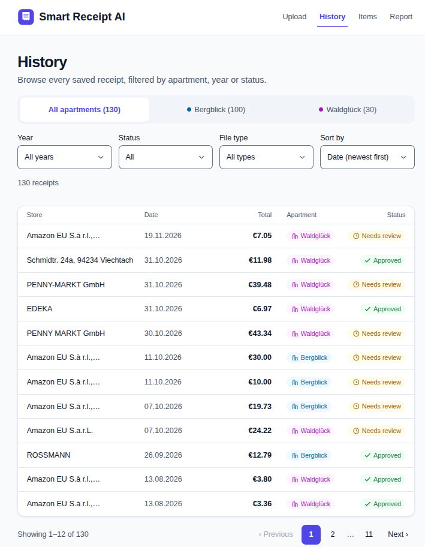
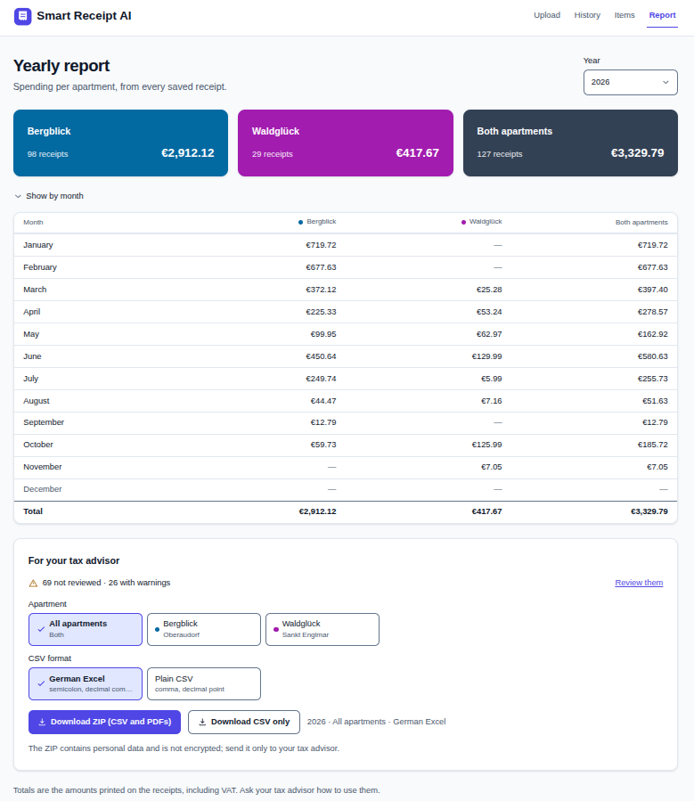

# Smart Receipt AI

Keep, check and total the shopping receipts of two holiday apartments, ready
for the year-end tax report.


## What it does

I rent out two holiday apartments in Germany (Bergblick and Waldglück) and
buy things for them all year. At tax time every receipt has to be found,
sorted by apartment and added up. Typing them in by hand is slow and
error-prone.

With this app I upload a photo or PDF, the AI reads the store, date, items
and total, and I check the result next to the original. The app then adds
everything up per apartment and exports the year for my tax advisor.

It is built for one person, runs on my own computer and has no login. It is
not a multi-user product.

## Features

- **Upload:** up to 20 photos or PDFs at once, each assigned to an
  apartment. A file that is already saved is detected before the AI reads
  it again.
- **Check each receipt:** the original file (zoom, rotate) sits next to the
  extracted data. Edit, reset to the AI result, approve, or step through
  open receipts with "Approve and next". Warnings appear when the numbers
  do not add up or a date looks wrong.
- **History:** every receipt, colour-coded per apartment, with filters
  (apartment, year, status, file type), sorting (date, total, upload time)
  and pages.
- **Items:** every purchased line across all receipts, with search (also
  without umlauts: "musli" finds "Müsli"), filters, sorting and pages.
- **Yearly report:** totals per apartment and for both, a monthly table,
  and a short list of what is still open (not reviewed, warnings, possible
  duplicates).
- **Export for the tax advisor:** a CSV (German Excel or plain) or a ZIP
  with the CSV and every counted receipt as a PDF, for one or both
  apartments.
- **Backups:** scripts to back up and restore the database and files.

| History | Yearly report |
| --- | --- |
|  |  |

## Tech stack

- **Frontend:** React, TypeScript, Vite, Tailwind CSS; tests with Jest and
  React Testing Library.
- **Backend:** Python, FastAPI, SQLite; tests with pytest.
- **AI:** OpenAI API to read the receipts.
- **Architecture:** the backend has three layers (`domain`, `adapters`,
  `api`). The rules are checked automatically with import-linter, and the
  frontend layers with dependency-cruiser.

## Run it locally

You need:

- Python 3 (I use 3.12), Node.js with npm (a current LTS version) and Git.
- A Linux or macOS terminal. On Windows, use WSL or replace the activate
  command with `venv\Scripts\activate`.
- An OpenAI API key with credit. The API is billed separately from a
  ChatGPT subscription: create the key at platform.openai.com, add billing
  there and set a monthly limit. Each receipt is one API call.

Steps:

1. Get the code:
   ```bash
   git clone https://github.com/AiTrinh303/Smart-Receipt-AI.git
   cd Smart-Receipt-AI
   ```
2. Set up and start the backend:
   ```bash
   cd backend
   python3 -m venv venv
   source venv/bin/activate
   pip install -r requirements.txt
   cp -n .env.example .env     # then put your key in OPENAI_API_KEY
   uvicorn main:app --reload --port 8001
   ```
3. In a second terminal, start the frontend:
   ```bash
   cd frontend
   npm install
   cp -n .env.example .env
   npm run dev
   ```
4. Open <http://localhost:5173>.

The database and the uploads folder are created on the first run. After
changing `backend/.env`, restart uvicorn: `--reload` does not watch that
file.

**How to know it worked:**

- <http://localhost:8001/health> shows `{"status":"ok"}`.
- The Upload page shows the two apartments and a dashed upload area.
- Choose an apartment, add a receipt and click "Read receipt". After a few
  seconds the receipt page shows the store, date, items and total next to
  the original. Reloading the page shows the same result without a new AI
  call.

## Tests

```bash
cd backend && source venv/bin/activate
pip install -r requirements-dev.txt
pytest            # backend tests: temporary database, no OpenAI calls
lint-imports      # backend layer rules

cd ../frontend
npm test          # frontend tests
npm run check:deps
npm run build
```

## Where AI was used

- **In the product:** OpenAI reads each receipt. The AI's answer is stored
  unchanged, next to a working copy that I can edit. Plain rules (not AI)
  check the result and show warnings, for example when the items do not add
  up to the total. A receipt counts as checked only after I approve it.
- **In building it:** most of the code was written by Claude Code from
  small tickets. I planned the features and wrote the tickets together with
  a chat assistant, which also reviewed screenshots of the UI. Standing
  rules for the coding agent are in [CLAUDE.md](CLAUDE.md); important
  decisions are in [docs/adr/](docs/adr/).
- **How it was checked:** every change had to pass the tests, the layer
  checks and the build before it was committed. The coding agent cannot see
  the screen, so I checked every UI change myself in the browser, and I
  compared totals with real receipts.
- **What was not verified:** I did not read every generated line of code.
  The AI also misreads receipts (for example, a store's address taken as its
  name, or tax and payment lines taken as items), so each receipt should be
  checked against the original before it is approved.

## Live demo

- App: <https://smart-receipt-ai.onrender.com>
- API: <https://smart-receipt-ai-backend.onrender.com> (health check:
  `/health`)

Sample data only. There is no login, so anyone with the link can use it:
please do not upload real receipts. On the free plan the first request can
take a minute, and saved data may be lost when the service restarts.

## Privacy and known limits

- Receipt files are sent to OpenAI to be read. Deleting a receipt in the
  app does not delete that copy.
- No login: run it only on your own computer. Do not put a copy with real
  receipts on the internet.
- Backups and the export ZIP are not encrypted and contain personal data.
- Only identical files are detected as duplicates. A receipt photographed
  twice is listed as a possible duplicate in the report, but counted twice
  until one copy is deleted.
- Totals are the amounts printed on the receipts, including VAT. VAT is not
  split out. Ask a tax advisor how to use them.

## Backups

Run inside `backend/` with the venv active:

```bash
python scripts/backup.py                    # ZIP of database + uploads into ../backups/, keeps the newest 30
python scripts/backup.py --out DIR --keep 10
python scripts/restore.py ../backups/receipts-backup-<date>.zip --target DIR
```

`restore.py` checks the whole ZIP before writing anything and restores into
a separate folder, never over the live data. It refuses a folder that
already has data unless you add `--force`, which moves the old data aside
first.

## Project structure

```text
Smart-Receipt-AI/
├── backend/
│   ├── main.py          # entry point (uvicorn main:app)
│   ├── domain/          # pure rules: models, dates, money, warnings
│   ├── adapters/        # OpenAI, SQLite, uploads folder, PDF/ZIP export
│   ├── api/             # FastAPI routes and error handling
│   ├── scripts/         # backup, restore, backfill_hashes
│   └── tests/
├── frontend/src/
│   ├── api/             # calls to the backend
│   ├── components/ui/   # shared UI components
│   ├── batch/, format/, hash/, hooks/
│   └── *.tsx            # screens: upload, history, items, report, receipt
├── docs/
│   ├── adr/             # architecture decisions
│   ├── notes/           # detailed frontend and backend notes
│   ├── images/          # screenshots
│   └── design.md        # design rules
└── CLAUDE.md            # rules for the coding agent
```

Dependencies point inward: `api` → `adapters` → `domain`. The `domain`
layer never imports the others. The database (`backend/data/`), the
uploads, `.env` files and backups are not in Git.

## Deploy

- **Backend** (Render Web Service): Root Directory `backend`, Build
  `pip install -r requirements.txt`, Start
  `uvicorn main:app --host 0.0.0.0 --port $PORT`. Environment variables:
  `OPENAI_API_KEY` and `CORS_ORIGINS` (the frontend address, no trailing
  slash).
- **Frontend** (Render Static Site): Root Directory `frontend`, Build
  `npm install && npm run build`, Publish `dist`. Environment variable:
  `VITE_API_URL` (the backend address, no trailing slash). It is read at
  build time, so redeploy after changing it.
- The SQLite database (`DATABASE_PATH`) and `backend/uploads/` need
  persistent storage if the data must survive a restart.