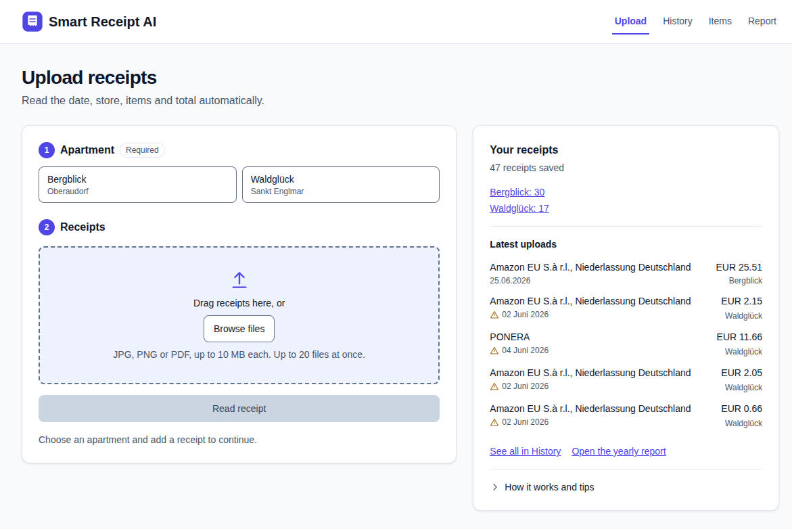

# Smart Receipt AI

Keep, check and archive receipts for two holiday apartments, ready for the
year-end tax report.

## What this is
A web app that stores the shopping receipts of my two holiday apartments in
Germany. I upload photos or PDFs, AI reads the date, store, items and total,
I check the result against the original, and the yearly report and export go
to my tax advisor. It is built for one person, the owner of the apartments,
and runs only on my own computer. It is not a multi-user product.



## Before you start
- Python 3 (I use 3.12) and Node.js with npm (a current LTS version). Check
  with `python3 --version` and `node --version`.
- Git, and a Linux or macOS terminal. On Windows, use WSL or replace the
  activate command with `venv\Scripts\activate`.
- An OpenAI API key with credit. The API is billed separately from a ChatGPT
  subscription: create the key at platform.openai.com and add billing there.
  Each receipt is one API call, so set a monthly limit and watch the usage
  page.
- `backend/.env` holds your key. Never commit it.

## How to run it
1. Get the code:
   ```bash
   git clone https://github.com/AiTrinh303/Smart-Receipt-AI.git
   cd Smart-Receipt-AI
   ```
2. Set up the backend:
   ```bash
   cd backend
   python3 -m venv venv
   source venv/bin/activate
   pip install -r requirements.txt
   cp -n .env.example .env
   ```
3. Open `backend/.env` and replace `your-key-here` with your real
   `OPENAI_API_KEY`.
4. Start the backend (same terminal):
   ```bash
   uvicorn main:app --reload --port 8001
   ```
5. In a second terminal, start the frontend:
   ```bash
   cd frontend
   npm install
   cp -n .env.example .env
   npm run dev
   ```
6. Open http://localhost:5173

After changing `backend/.env`, stop and restart uvicorn: `--reload` does not
watch that file. The database and the uploads folder are created
automatically on first run.

## How to know it worked
- http://localhost:8001/health shows `{"status":"ok"}`.
- http://localhost:5173 shows the Upload page with two apartment cards
  (Bergblick and Waldglück), nothing pre-selected, and a dashed upload area.
- Choose an apartment, add a receipt photo or PDF and click "Read receipt".
  After a few seconds the receipt page shows the store, date, items and total
  next to the original file. Reload the page: the same result appears without
  a new AI call.
- The tests pass (see [Tests](#tests)).

## What it does not do yet
- No login. Use it only on your own machine and do not expose it to the
  internet.
- Only a byte-for-byte identical file is caught as a duplicate. A second
  photo of the same receipt is only flagged in the yearly report's quick
  check (same apartment, date, store and total).
- No bulk approval: receipts are approved one at a time, with a review mode
  that moves to the next one.
- Item search does not ignore accents: "Cafe" does not find "Café".
- No VAT split: totals are the gross amounts printed on the receipt.
- Files that were uploaded but never read (for example, the AI failed and
  you gave up) stay in `backend/uploads/`. Nothing cleans them up.
- Backups are manual (see [Backups](#backups)).
- A batch is kept only in the open browser tab: receipts not yet read are
  lost if you close it (the browser warns you while one is being read).
- The AI can misread a receipt. Check each one against the original.
- Receipt files are sent to OpenAI to be read, and deleting a receipt here
  cannot delete that copy.
- The yearly export ZIP is **not encrypted** and contains personal data
  (receipt photos/PDFs and amounts). Handle and send it the same way you
  would the original receipts.

## Where the decisions live
Why it is built this way, in short:
- **Three layers (domain, adapters, api).** The rules do not depend on
  OpenAI, SQLite or FastAPI, so changing the AI provider or the database
  means editing one adapter, and the tests need no API key. A check
  (`import-linter`) fails if the domain imports an outer layer.
- **Every receipt keeps two copies of its data:** the untouched AI output and
  a working copy I can edit. That gives an audit trail for tax purposes and a
  "Reset to AI result" button.
- **Money is never a floating-point number.** Amounts use exact decimals so
  totals add up.
- **Warnings do not block.** A total that does not match or an odd date only
  warns me. Approving needs three things: an apartment, a valid date and a
  total. Approval is optional: the report counts every receipt by default.
- **One apartment per receipt, no categories.** The report only needs
  apartment, year and review status, so categories were removed.
- **No login, one local SQLite file.** It is a personal tool, so I kept it
  simple and listed the risk above.
- **Duplicate files are caught by content, not by name.** Each upload is
  hashed (SHA-256, a fingerprint of the file's bytes) before anything is
  saved or sent to the AI. If an identical file is already saved, the app
  shows the existing receipt and only uploads it again if I click "Upload
  anyway". Receipts saved before this existed have no fingerprint until
  `python scripts/backfill_hashes.py` is run once inside `backend/` (venv
  active); `--dry-run` previews it, and `--report` lists receipts that
  already share an identical file.

The decisions are written down in `docs/adr/` (architecture decision
records):
- [ADR 0001: layered backend](docs/adr/0001-layered-backend.md)
- [ADR 0002: apartments and the expense ledger](docs/adr/0002-apartments-and-expense-ledger.md)
- [ADR 0003: category and review status](docs/adr/0003-category-and-review-status.md), superseded by 0004
- [ADR 0004: remove categories](docs/adr/0004-remove-categories.md)

The plan and backlog are the
[GitHub issues](https://github.com/AiTrinh303/Smart-Receipt-AI/issues), each
with acceptance criteria. Design rules: [docs/design.md](docs/design.md).
Rules for the AI assistant: [CLAUDE.md](CLAUDE.md), with details in
[docs/notes/](docs/notes/).

## Features
- Upload one receipt or up to 20 at once (photo or PDF); AI reads the store,
  date, items and total.
- Check each receipt next to its original file, edit it, reset it to the AI
  result, approve it, and download it as a PDF.
- History (receipts) and Items (every purchased line): filter by apartment,
  year and review status; search and sort items.
- Yearly report per apartment, with a quick check of warnings, possible
  duplicates and the largest receipts.
- Download the yearly report as CSV, or as a ZIP with every receipt as a PDF,
  for the tax advisor.
- Warns before reading a file that is already saved, so the AI does not read
  it twice unless you choose "Upload anyway".
- The Upload page shows your latest uploads and the count per apartment.

## Where AI was used
- **In the product:** OpenAI reads each receipt. The untouched AI output is
  kept next to an editable working copy, and the app warns when the numbers
  do not add up.
- **In building it:** most code was written by Claude Code from tickets I
  wrote with a chat assistant. I chose the scope and wrote the decisions in
  `docs/adr/`.
- **How it was checked:** `pytest`, `npm test`, the layering checks
  (`lint-imports`, `npm run check:deps`), and trying real receipts in the
  browser and comparing the totals with the originals.
- **What was not verified:** I did not read every generated line, and the AI
  can misread a receipt, so totals must be checked against the original.

## Project structure
```text
Smart-Receipt-AI/
├── backend/
│   ├── main.py            # entry point (uvicorn main:app)
│   ├── config.py          # settings from .env (API key, database path)
│   ├── domain/            # pure rules: models, dates, money, warnings, interfaces
│   ├── adapters/          # outside world: OpenAI, SQLite, uploads folder, PDF/ZIP export
│   ├── api/               # FastAPI routes and error handling
│   ├── scripts/           # backup.py, restore.py, backfill_hashes.py
│   ├── tests/             # pytest
│   ├── data/              # SQLite database (not in git)
│   └── uploads/           # original receipt files (not in git)
├── frontend/
│   ├── public/            # favicon and icons
│   └── src/
│       ├── api/           # calls to the backend
│       ├── batch/         # upload queue
│       ├── components/ui/ # shared UI components
│       ├── format/        # display helpers (dates, apartment names)
│       ├── hash/          # file fingerprint (SHA-256) in the browser
│       ├── hooks/         # React hooks
│       └── *.tsx          # screens: upload, history, items, report, receipt
├── docs/
│   ├── adr/               # architecture decisions
│   ├── images/            # README screenshot
│   ├── notes/             # detailed frontend/backend notes
│   └── design.md          # design rules
├── CLAUDE.md              # rules for the AI assistant
└── README.md
```
Dependencies point inward: `api` → `adapters` → `domain`. The domain never
imports the others. Backups go to `backups/` (created by the backup script,
not in git).

## Background
Entering receipt details (store, date, items, prices, tax, total) by hand
for every purchase is slow and error-prone, and at tax time every receipt
has to be found again, sorted by apartment and added up. This app does the
reading and the adding up; I do the checking.

## Tests
```bash
cd backend && source venv/bin/activate
pip install -r requirements-dev.txt
pytest          # backend tests (temporary database, no OpenAI calls)
lint-imports    # checks the layers
cd ../frontend
npm test        # frontend tests
npm run check:deps
```

## Backups
Run inside `backend/` with the venv active:
```bash
python scripts/backup.py                 # zip of database + uploads into ../backups/, keeps the newest 30
python scripts/backup.py --out DIR --keep 10
python scripts/restore.py ../backups/receipts-backup-<date>.zip --target DIR
```
`restore.py` checks the whole ZIP before writing anything and restores into
a separate folder, never over the live data. It refuses a folder that
already has data unless you add `--force`, which moves the old data aside
first.

## Troubleshooting
- **"The AI service is not available"**: the key in `backend/.env` is
  missing, wrong or out of credit. Fix it and restart the backend.
- **"Could not reach the server"**: the backend is not running, or
  `VITE_API_URL` in `frontend/.env` does not match its port (8001).
- **The frontend runs on another port than 5173**: add that address to
  `CORS_ORIGINS` in `backend/.env` (comma-separated) and restart the
  backend; otherwise the browser blocks the requests.
